# StegSuite 使用说明书

> **版本**：StegSuite 1.0（`stegsuite-1.0.0-all.jar`）  
> **适用读者**：CTF 选手（Misc / 隐写方向）、工具维护者  
> **文档日期**：2026-10  
> **运行环境**：Java 8 及以上（Swing 桌面程序）

StegSuite 是一个用 Java 8 / Swing 编写的**图片取证与 CTF Misc 分析工具**。它把 Stegsolve、zsteg、binwalk、pngcheck 类 CRC 校验、PNG 宽高修复脚本、JSteg 提取与若干经典隐写分析算法（卡方攻击、RS、SPA、校准）整合进同一个窗口，并且可以批量扫描文件夹、导出 HTML / Markdown / JSON 报告。

> **重要：StegSuite 只做分析，不做嵌入。** 程序中没有任何功能会往图片里写入隐藏数据。它写出的文件只有：报告、提取出的数据流、各视图/结果图片（位平面视图、Combiner 结果、立体图结果、GIF/APNG 帧）以及修复后的 PNG 副本。**原始文件永远不会被修改。**

界面中的按钮、菜单、选项均为英文。本手册引用界面文字时一律保留原英文（如 **Auto scan**、**PNG size repair...**），并附中文说明，方便与程序界面一一对照。

<!-- toc-start -->
## 目录

- [1 简介与功能总览](#1-简介与功能总览)
- [2 安装与运行](#2-安装与运行)
- [3 界面总览](#3-界面总览)
- [4 各标签页详解](#4-各标签页详解)
- [5 批量扫描与报告导出](#5-批量扫描与报告导出)
- [6 典型 CTF 解题流程](#6-典型-ctf-解题流程)
- [7 快捷键一览](#7-快捷键一览)
- [8 常见问题 FAQ](#8-常见问题-faq)
- [9 已知限制](#9-已知限制)
- [10 致谢与第三方说明](#10-致谢与第三方说明)
<!-- toc-end -->

## 1 简介与功能总览

### 1.1 设计目标

做 CTF 隐写题时，常见的做法是轮流打开 Stegsolve 看位平面、用 zsteg 扫 LSB、用 binwalk 找附加文件、用 pngcheck 查 CRC、再跑一个 Python 脚本爆破 PNG 宽高。StegSuite 把这些步骤合并到一个程序里，做到：

- **一次打开，所有标签页同时拿到同一个文件**：在任何标签页拖入图片，其余标签页都会同步刷新。
- **自动化与手动并存**：既能像 Stegsolve 一样手工勾选位平面，也能像 zsteg 一样一键自动扫描并按可信度排序。
- **结论可导出**：单文件报告（Ctrl+E）和文件夹批量扫描（Ctrl+B）都能导出为 HTML / Markdown / JSON。
- **耗时任务全部在后台运行**，带进度条和 **Cancel** 按钮，界面不会卡死。

### 1.2 标签页总览

主窗口共有 9 个标签页，序号即命令行参数 `--tab N` 中的 N：

| `--tab` | 标签页（界面名称） | 主要功能 | 对应 / 整合自 |
|---|---|---|---|
| 0 | **Bit planes** | 位平面、颜色反转、灰度位、随机调色板等 44 种视图；LSB 卡方热力图 | Stegsolve 的主视图浏览 |
| 1 | **Data extract / scan** | 手动按位平面/通道顺序提取数据；QUICK / DEEP 自动扫描，在任意偏移处搜索 flag、文件头、文本 | Stegsolve「Data Extract」+ zsteg |
| 2 | **File format** | PNG 块与 CRC、宽高爆破与修复、JPEG 标记/EXIF/量化表/质量估计、BMP、GIF 结构；文件尾附加数据；内嵌文件签名；原始文件十六进制 | Stegsolve「File Format」+ pngcheck + binwalk + Deformed-Image-Restorer |
| 3 | **Frames** | GIF / APNG 逐帧浏览，支持按 disposal/blend 规则合成 | Stegsolve「Frame Browser」 |
| 4 | **Combiner** | 当前图与第二张图做 XOR / AND / OR / ADD / SUB / 交错等运算 | Stegsolve「Image Combiner」 |
| 5 | **Stereogram** | 自动立体图（魔眼图）求解：与水平平移后的自身做 XOR 或差值 | Stegsolve「Stereogram Solver」 |
| 6 | **JPEG DCT** | 自行解码 JPEG 的 DCT 系数：直方图、卡方攻击曲线、校准（F5 β 估计）、块热力图、JSteg 及其变体提取 | JSteg / jpseek、stegdetect 一类工具的思路 |
| 7 | **Detection** | RS 分析 + SPA（样本对分析），按通道估计 LSB 替换嵌入率 | 经典空域隐写分析算法 |
| 8 | **Batch scan** | 文件夹批量扫描，按「可疑度分数」排序，可导出批量报告 | — |

此外还有两个菜单功能：**File > Export report...**（Ctrl+E，导出当前文件的综合报告）和 **File > Batch scan folder...**（Ctrl+B，跳转到 Batch scan 并选择文件夹）。

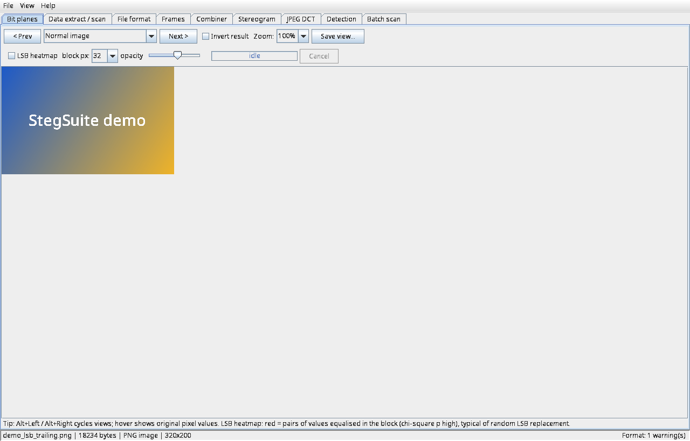

### 1.3 支持的文件

- **图像解码**使用 JRE 自带的 `ImageIO`：PNG、JPEG、BMP、GIF 在所有 Java 版本上可用（其它格式取决于所用 JRE 的 ImageIO 插件）。解码后统一转为 ARGB 处理。
- **结构分析**（File format 标签页）专门支持 PNG、JPEG、BMP、GIF；文件类型按**文件内容（魔数）**识别，而不是扩展名。
- **任意文件都可以打开**：即使不是可解码图像（状态栏会显示 `not decodable as image`），File format 标签页仍会做内嵌签名搜索、flag 字符串搜索和十六进制查看。
- **帧浏览**支持 GIF 与 APNG。
- **JPEG DCT** 支持 baseline、extended sequential、progressive 的 Huffman 编码 JPEG（含 restart 标记）；算术编码、12 位精度 JPEG 以及 CMYK/YCCK 布局会明确报告为不支持，而不是猜测结果。

## 2 安装与运行

### 2.1 环境要求

- **Java 8 或更高版本**（class 文件版本为 Java 8，major version 52）。作者实测：Temurin 1.8.0_504 与 OpenJDK 21。
- 需要**非 headless** 的 JRE（有图形界面的桌面环境）。在纯服务器上可以用 Xvfb 虚拟显示。
- 无任何第三方运行时依赖，单个 `stegsuite-1.0.0-all.jar` 即可运行。

### 2.2 从源码构建

```bash
mvn package
# 产物：target/stegsuite-1.0.0-all.jar（构建时会运行无界面的 JUnit 测试）
```

- 使用 JDK 9+ 构建时，编译参数为 `--release 8`，会拒绝任何 Java 8 之后才有的 API，保证产物能在 Java 8 上运行。
- 使用 JDK 8 构建时，会自动启用 `jdk8-build` profile，改用 `-source/-target 1.8`。

### 2.3 启动方式与命令行参数

```bash
java [-Dstegsuite.scale=1.5] [-Dstegsuite.stereoOffset=N] -jar stegsuite-1.0.0-all.jar [image] [--tab N]
```

在大多数桌面系统上也可以直接双击 jar 启动（不带参数）。

| 参数 | 作用 | 示例 |
|---|---|---|
| `[image]` | 启动后立即打开的文件（任意一个非 `--tab` 的参数都视为文件路径） | `java -jar stegsuite-1.0.0-all.jar flag.png` |
| `--tab N` | 启动后切换到第 N 个标签页（0–8，见 1.2 节表格；超出范围会被截到有效范围） | `--tab 2` 直接进入 File format |
| `-Dstegsuite.scale=...` | 界面缩放倍数，**覆盖** View > UI scale 中保存的设置。可写 `1.5`、`150%` 或 `auto`；显式数值被限制在 50%–400% | `-Dstegsuite.scale=2` |
| `-Dstegsuite.stereoOffset=N` | Stereogram 标签页打开文件时的初始偏移量 | `-Dstegsuite.stereoOffset=60` |
| `-Xmx...`（JVM 通用参数） | 分析超大图片时增大堆内存；内存不足时程序会提示 `Out of memory ... (try -Xmx).` | `-Xmx4g` |

几个常用组合：

```bash
# 打开图片并直接进入自动扫描页
java -jar stegsuite-1.0.0-all.jar challenge.png --tab 1

# 打开立体图，初始偏移 60
java -Dstegsuite.stereoOffset=60 -jar stegsuite-1.0.0-all.jar samples/demo_stereogram.png --tab 5

# Java 8 + 2K/4K 屏，界面放大 2 倍
java -Dstegsuite.scale=2 -jar stegsuite-1.0.0-all.jar

# 加载额外的 JPEG 插件（Windows 下把 : 换成 ;）
java -cp stegsuite-1.0.0-all.jar:plugin.jar org.stegsuite.Main
```

### 2.4 界面缩放（HiDPI）

Java 9+ 会在高 DPI 屏上自动缩放 Swing；**Java 8 不会**，所以在 Windows 缩放设为 125% / 150% / 200% 的屏幕上，Java 8 下的界面会显得很小。StegSuite 因此在 Java 8 上自行缩放：

- **Auto（默认）**：在 Java 8 上，倍数 = 屏幕 DPI / 96（例如 144 dpi → 150%），按 25% 取整，限制在 100%–300%；在 Java 9+ 上 Auto 始终为 100%，因为 JVM 已经缩放过（避免双重缩放）。
- **View > UI scale**：可选 `Auto (xx%)` / `100%` / `125%` / `150%` / `175%` / `200%`。选择后会弹窗提示 *Restart StegSuite to apply*——**重启后才生效**。设置用 `java.util.prefs` 保存：
  - Windows：注册表 `HKCU\Software\JavaSoft\Prefs\org\stegsuite`
  - Linux：`~/.java/.userPrefs/org/stegsuite`
  - 在 Java 9+ 上，显式选择的倍数会叠加在 JVM 自身的缩放之上。
- **命令行**：`-Dstegsuite.scale=1.5`（也接受 `150%` 或 `auto`），优先级最高，会覆盖菜单中保存的设置；此时在菜单中切换缩放，提示框会注明命令行参数覆盖了该设置。

缩放范围包括：字体（含十六进制视图、报告等等宽字体）、表格/树行高、边距、滚动条和分隔条宽度、复选框/单选框/菜单图标、各面板的固定尺寸，以及默认窗口大小（会被限制在屏幕范围内）。**图片缩放（Zoom）与界面缩放互相独立。**

当前生效的倍数及其来源可在两处查看：**View > UI scale** 子菜单底部的灰色项 `Current: 100% - auto (100 dpi)`，以及 **Help > About**。来源可能是 `-Dstegsuite.scale`、`preference`（菜单保存值）、`auto (Java 21 scales itself)` 或 `auto (NNN dpi)`。

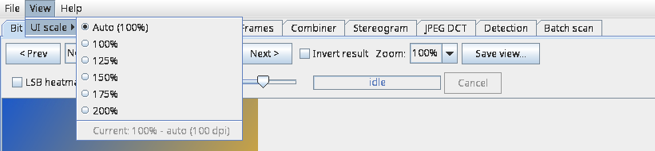

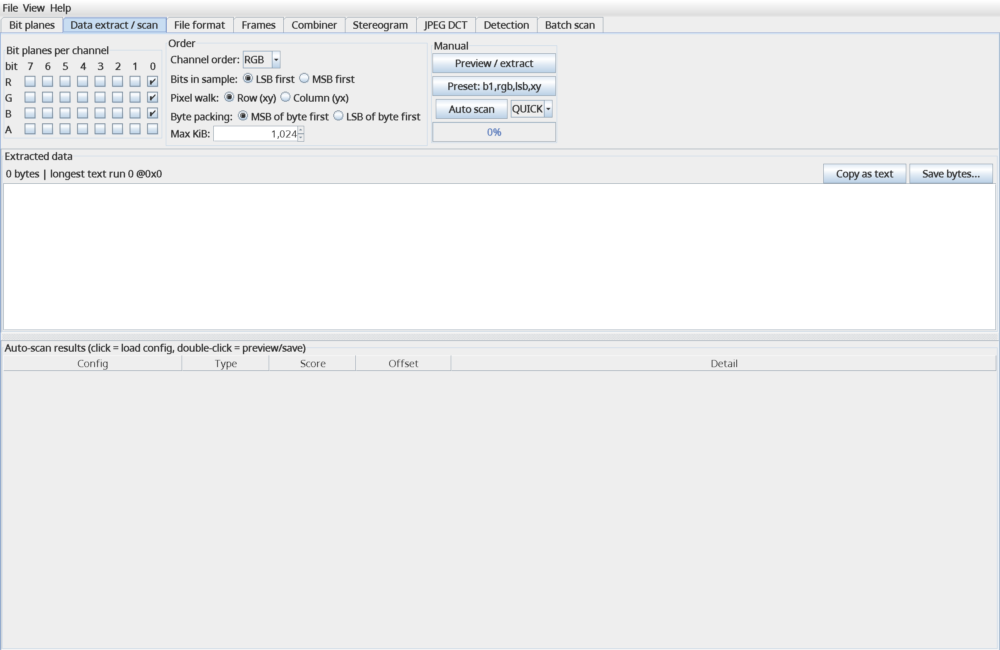

## 3 界面总览

### 3.1 菜单

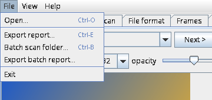

| 菜单 | 菜单项 | 快捷键 | 说明 |
|---|---|---|---|
| **File** | **Open...** | Ctrl+O | 打开文件 |
| | **Export report...** | Ctrl+E | 为当前文件生成综合报告（HTML / Markdown / JSON），详见第 5 章 |
| | **Batch scan folder...** | Ctrl+B | 切换到 Batch scan 标签页并弹出文件夹选择框 |
| | **Export batch report...** | — | 导出批量扫描结果；尚未扫描时提示 *Run a batch scan first (Batch scan tab).* |
| | **Exit** | — | 退出 |
| **View** | **UI scale** ▸ | — | 界面缩放（见 2.4 节） |
| **Help** | **About** | — | 版本、Java 版本、当前 UI 缩放倍数及来源、功能简介 |

> macOS 上快捷键的 Ctrl 对应 Cmd（程序使用系统的菜单快捷键修饰键）。

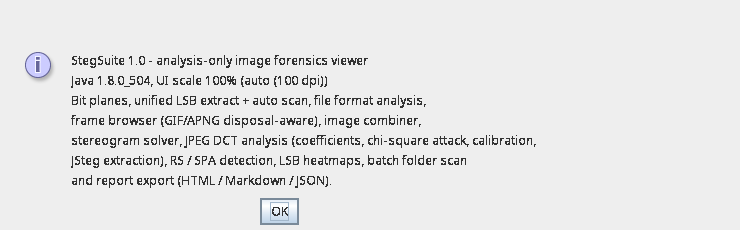

### 3.2 标签页

窗口中部是 9 个标签页（见 1.2 节）。打开一个文件后，**所有标签页都会收到该文件**：Bit planes 立即显示图像，File format 在后台分析，Frames 拆帧，Detection / JPEG DCT 准备好按钮等。切换文件时，正在运行的上一文件的后台任务会被取消。

### 3.3 状态栏

窗口底部的状态栏分左右两部分：

- **左侧：文件信息**，格式为 `文件名 | 字节数 | 识别出的类型 | 宽x高`。若无法作为图像解码，最后一项显示 `not decodable as image`；尚未打开文件时显示 `No file - drag & drop an image or use File > Open`。
- **右侧：临时消息**，例如 `Format: 1 warning(s)`、自动扫描完成信息、任务耗时、保存路径。**鼠标悬停在图像上时**显示该像素的坐标和**原图**的 ARGB 值（如 `x=12 y=34  ARGB=ff 3a 7c 10`）；如果开启了热力图，还会附加 `heat p=0.873`（该块的卡方 p 值）。

### 3.4 打开文件与拖放

- **File > Open...**（Ctrl+O）或命令行参数。
- **拖放**：把文件拖到窗口内**任意位置**即可打开；一次拖入多个文件时只打开第一个。
- 文件选择框会记住上次使用的目录。

### 3.5 通用控件

几个标签页共用以下控件，后文不再重复：

| 控件 | 说明 |
|---|---|
| **Zoom:** | 图片缩放 25% / 50% / 100% / 200% / 400% / 800%，最近邻插值（放大后像素清晰可见，便于看 LSB 图案） |
| **Save view...** / **Save result...** / **Save frame...** | 把当前显示的图像保存为 PNG，默认文件名包含原文件名和视图名 |
| 十六进制查看器 | 显示「偏移 + 十六进制 + ASCII」，顶部显示 `N bytes \| longest text run L @0x...`（最长可打印文本串的长度和位置）。**Copy as text** 把数据按文本复制到剪贴板，**Save bytes...** 保存全部字节。为保证流畅，最多显示前 256 KiB（保存时不受此限制） |
| 后台任务进度条 + **Cancel** | 空闲时显示 `idle`，运行时显示任务名，结束后显示 `done (N ms)` 或 `cancelled` |

## 4 各标签页详解

### 4.1 Bit planes（位平面）

**用途**：Stegsolve 式的图像变换浏览，用于肉眼发现 LSB 中的图案、文字、二维码，以及调色板/颜色异常。

**控件**

| 控件 | 说明 |
|---|---|
| **< Prev** / 下拉框 / **Next >** | 切换视图；**Alt+Left / Alt+Right** 同样可以循环切换（首尾相接） |
| **Invert result** | 把当前视图的结果再做一次颜色反转（XOR 0xFFFFFF） |
| **Zoom:** / **Save view...** | 见 3.5 节；保存文件名形如 `原名_Red_plane_0.png` |
| **LSB heatmap** | 勾选后叠加半透明的 LSB 卡方热力图（后台计算，可取消） |
| **block px:** | 热力图块大小：8 / 16 / 32（默认）/ 64 / 128 像素 |
| **opacity** | 热力图透明度滑块 |

**视图列表**（共 44 个，按下拉框顺序）：

1. `Normal image` —— 原图
2. `Colour inversion (XOR 0xFFFFFF)` —— 颜色反转
3. `Red plane 7` … `Red plane 0`，`Green plane 7` … `0`，`Blue plane 7` … `0`，`Alpha plane 7` … `0` —— 单个位平面，该位为 1 显示白色，为 0 显示黑色
4. `Full red` / `Full green` / `Full blue` / `Full alpha` —— 单通道灰度显示
5. `Random colour map 1` / `2` / `3` —— 随机调色映射（固定种子），把相近的颜色值映射成反差很大的颜色，能暴露肉眼看不出的细微色差
6. `Gray bits (R==G==B)` —— R、G、B 三值相等的像素显示白色，其余黑色
7. `Grayscale` —— 灰度
8. `XOR with right neighbour` —— 每个像素与右侧相邻像素做异或，突出局部差异

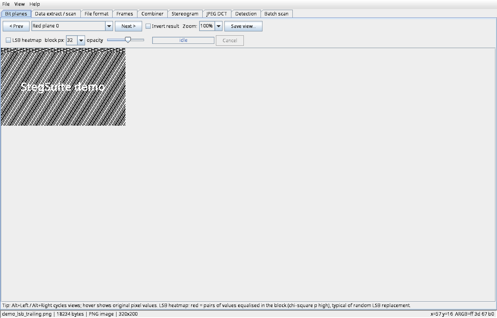

**LSB 热力图怎么看**

勾选 **LSB heatmap** 后，程序把图像分成 `block px` 大小的块，对每块内所有通道的 LSB 值对 (2i, 2i+1) 做卡方检验：

- **红色**：值对被「拉平」（p 值高），这是随机 LSB 替换的典型特征；
- **蓝色**：自然分布；
- **无颜色**：该块样本太少，无法判断。

鼠标悬停可在状态栏看到该块的 p 值。平滑或大面积纯色的载体图上热力图很可靠；**噪声大的照片也会出现零散红块**，需要结合其它证据判断。

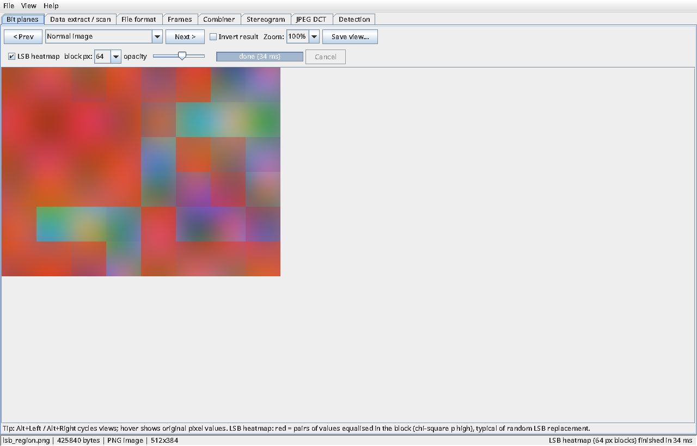

**技巧**

- 先用 Alt+Right 快速扫过 R/G/B 的 plane 0–2，再看 Alpha plane（很多题目把数据放在 Alpha 通道）。
- 发现某个平面的上方有「噪声带」而下方干净，基本可以判断是顺序写入的 LSB 数据，转到 Data extract 提取。
- 二维码类题目把 Zoom 调到 200%/400% 后 **Save view...**，再用扫码工具识别。
- 对 JPEG 看位平面意义不大（有损压缩），JPEG 请用 JPEG DCT 标签页。

### 4.2 Data extract / scan（数据提取 / 自动扫描）

**用途**：把像素中指定位按指定顺序拼成字节流（Stegsolve Data Extract），或一键自动尝试大量组合并在结果中搜索 flag、文件头和文本（zsteg 风格）。

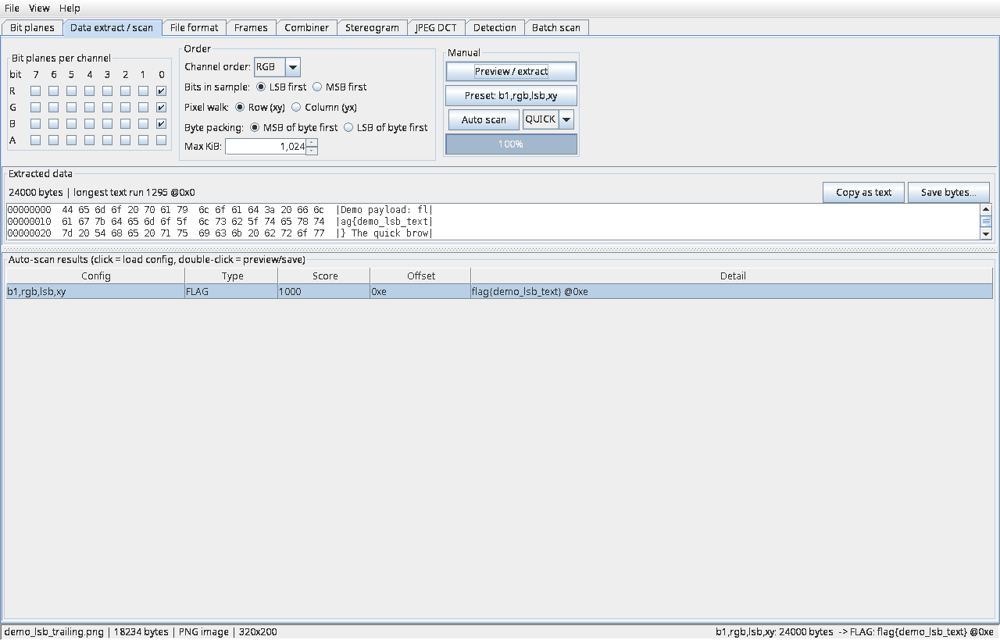

#### 4.2.1 手动模式

| 区域 / 控件 | 说明 |
|---|---|
| **Bit planes per channel** | 4 行（R/G/B/A）× 8 列（bit 7…0）的复选框，勾选要提取的位。默认勾选 R、G、B 的 bit 0 |
| **Channel order:** | 通道读取顺序：RGB、RBG、GRB、GBR、BRG、BGR、RGBA、ARGB、ABGR、BGRA |
| **Bits in sample:** | **LSB first**（每个通道样本内从低位到高位读）/ **MSB first** |
| **Pixel walk:** | **Row (xy)**（逐行）/ **Column (yx)**（逐列） |
| **Byte packing:** | **MSB of byte first**（先读到的位放在字节最高位，常见）/ **LSB of byte first** |
| **Max KiB:** | 最多提取多少 KiB（默认 1024） |
| **Preview / extract** | 按当前设置提取，结果显示在 **Extracted data** 十六进制区；状态栏显示配置标签、字节数，以及识别到的第一个结果（如 `-> FLAG: flag{...}`） |
| **Preset: b1,rgb,lsb,xy** | 一键恢复最常见的设置：R、G、B 的 bit 0，RGB 顺序，LSB first，逐行 |

#### 4.2.2 自动扫描（Auto scan）

选择扫描级别后点 **Auto scan**；扫描期间按钮变为 **Cancel scan**，可随时取消。扫描在多线程中并行进行，进度条显示已完成的组合数，结束后状态栏显示 `QUICK auto scan finished: N hits from M combinations in T ms`。

| 级别 | 尝试的组合 | 每个组合提取的字节数 |
|---|---|---|
| **QUICK** | 通道 r、g、b、rgb、bgr（有 Alpha 时加 a、rgba、abgr）；b1–b4 以及单独的 plane 1、2、3、7；lsb/msb；xy/yx；两种字节打包方式 | 256 KiB |
| **DEEP** | QUICK 的全部 + b5、b6、b7、b8，每个单独位平面 0–7，排列 rbg/grb/gbr/brg（有 Alpha 时加 argb、bgra），以及有限的混合集合：在 rgb/bgr(/rgba) 上每通道分别取 b0/b1/b2 位宽，例如 `b1r+b2g,rg,lsb,xy` | 512 KiB |

**每条提取流都在任意偏移处搜索**：

- **FLAG**：`flag{...}`、`ctf{...}`、`key{...}` 以及 `xxxctf{...}`（2–8 个字母加 ctf）形式，不区分大小写；
- **FILE**：文件签名。偏移 0 处出现文件头即算命中；在其它偏移处，则要求至少 6 字节魔数**并且**头部字段合理（例如 ZIP 的版本/压缩方法、JFIF/Exif 标签、RIFF 类型），以减少误报。可识别的类型包括 PNG、JPEG、GIF、BMP、ZIP、RAR、7-Zip、GZIP、BZIP2、XZ、PDF、ELF、DOS/PE、SQLite、PSD、TIFF、OGG、FLAC、MP3(ID3)、MIDI、Java class、PGP、PEM 等；
- **TEXT**：自然文本。偏移 0 处 ≥ 8 个可打印字符；或任意位置 ≥ 20 个字符且像单词、或是很长的 base64/hex 串。渐变/纯色区域产生的重复字符会被过滤。

#### 4.2.3 结果表与配置标签

**Auto-scan results** 表格列：

| 列 | 含义 |
|---|---|
| **Config** | zsteg 风格的配置标签（见下） |
| **Type** | FLAG / FILE / TEXT |
| **Score** | 排序分数，只用于排序 |
| **Offset** | 命中位置在提取流中的偏移（十六进制） |
| **Detail** | 命中内容，如 `flag{demo_lsb_text} @0xe`、文件类型、文本预览 |

排序规则：**FLAG > 偏移 0 处的 FILE > 其它偏移的内嵌 FILE > TEXT**；参数越「奇特」（位数多、混合掩码、packLSB、yx、非常规通道排列）会被轻微扣分，所以**最简单的匹配配置排在最前**。

- **单击**一行：把该行配置加载到上方手动区（复选框、顺序、方向都会被设置好），再点 **Preview / extract** 即可在主十六进制区看到完整数据；
- **双击**一行：弹出独立窗口显示该数据流，可 **Save bytes...** 保存（例如命中 ZIP 时直接存成 .zip）。

**配置标签格式**：`位宽,通道,样本内位序,遍历方向[,packLSB]`

| 标签片段 | 含义 |
|---|---|
| `b1` / `b2` … `b8` | 每个通道取最低的 1 / 2 … 8 位（b1 即 bit 0，b2 即 bit 0–1） |
| `m80`、`m02` 等 | 非「从最低位连续」的掩码，十六进制表示，如 `m80` = 只取 bit 7，`m02` = 只取 bit 1 |
| `b1r+b2g` | 混合位宽：R 取 1 位，G 取 2 位 |
| `rgb` / `bgr` / `a` … | 参与的通道及其顺序 |
| `lsb` / `msb` | 样本内先读低位还是高位 |
| `xy` / `yx` | 逐行 / 逐列 |
| `packLSB` | 字节打包为 LSB of byte first（缺省为 MSB first，不显示） |

**技巧**

- 一般先跑 QUICK（快，覆盖绝大多数题目），没结果再跑 DEEP。
- 命中 TEXT 但内容像乱码时，往往是噪声误报，参见 FAQ。
- 看到 FILE 命中（如 `ZIP archive`）且偏移不为 0，说明数据前面有一段头部（长度字段、密码提示等），保存后用 `dd` 或十六进制编辑器切掉即可。

### 4.3 File format（文件格式分析）

**用途**：解析文件结构、校验 CRC、发现宽高篡改、文件尾附加数据、内嵌文件、EXIF/注释等元数据。左侧为文本报告，右侧 **Raw file** 为整个文件的十六进制视图。

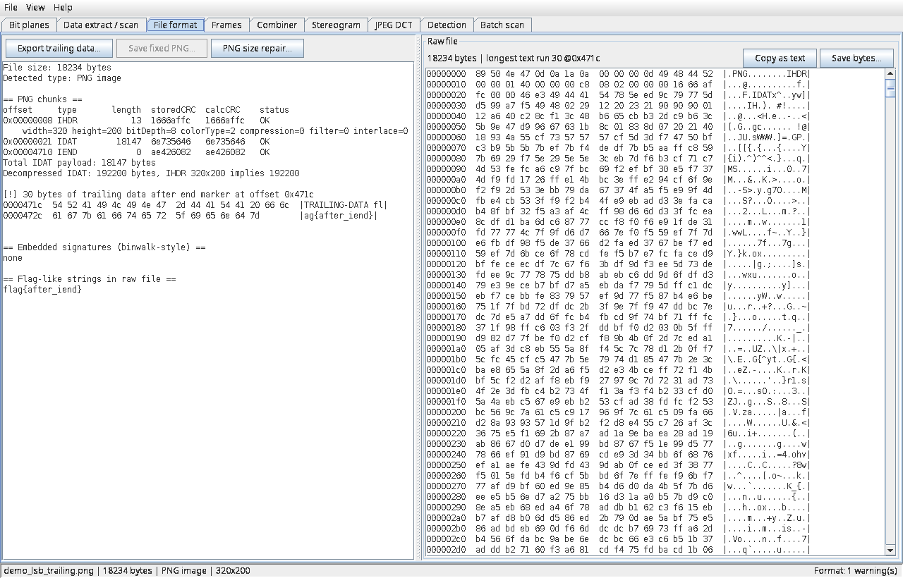

**顶部按钮**

| 按钮 | 何时可用 | 作用 |
|---|---|---|
| **Export trailing data...** | 检测到结束标记后的附加数据时 | 把结束标记之后的所有字节保存为 `原名_trailing.bin` |
| **Save fixed PNG...** | 自动 IHDR 爆破找到了与存储 CRC 匹配的宽高时 | 直接保存修正宽高后的 PNG（`原名_fixed.png`） |
| **PNG size repair...** | 打开的是 PNG 时 | 打开 PNG 宽高修复对话框（见 4.3.2） |
| `JPEG quality: N` 标签 | 打开的是 JPEG 时 | 显示亮度量化表对应的 IJG 质量：`(standard tables)` 表示精确匹配 libjpeg 缩放的 Annex K 表，`~N (estimated)` 表示最小二乘估计值 |

**报告内容**

- **PNG**：每个块的偏移、类型、长度、存储 CRC、计算 CRC 与状态；IHDR 字段（宽、高、位深、颜色类型、压缩、过滤、隔行）；`tEXt` / `zTXt`（自动解压）/ `iTXt` 文本；`acTL`（APNG 帧数）、`pHYs`；IDAT 总长度及**解压后大小与 IHDR 理论大小的对比**。会警告：CRC 不匹配、块长度越界、缺少 IEND、**非标准块类型**（可能藏数据）、IDAT 大小与 IHDR 不符（宽高很可能被改）。IHDR CRC 不匹配时，报告会自动做宽高爆破并给出匹配的尺寸。
- **JPEG**：列出每个标记段（偏移、长度），SOF 中的尺寸与分量数，`COMMENT`（COM 段内容），EXIF（IFD0 / Exif IFD / GPS，如 Artist、Copyright 等标签），量化表与**估计的 JPEG 质量**，扫描段数量。会警告：填充字节、段之间的游离字节、段超出文件末尾、**缺少 EOI**（文件被截断或扫描数据损坏）。只有在真正的 EOI 之后才报告附加数据。DCT 层的分析请到 JPEG DCT 标签页。
- **BMP**：头部字段；警告保留字段非零（可能藏数据）、声明大小与实际不符、像素数据被截断。
- **GIF**：版本、逻辑屏幕尺寸、全局调色板；每个图像块的位置与尺寸；注释扩展（COMMENT）、应用扩展、纯文本扩展内容；帧数；缺少结尾符 0x3B 或未知块会警告。
- **通用部分**（所有文件）：
  - `[!] N bytes of trailing data after end marker at offset 0x...` —— 文件尾附加数据，附带开头部分的十六进制预览；
  - `== Embedded signatures (binwalk-style) ==` —— 文件中任意位置的内嵌文件签名（类似 binwalk）；
  - `== Flag-like strings in raw file ==` —— 原始字节中直接出现的 flag 形式字符串。

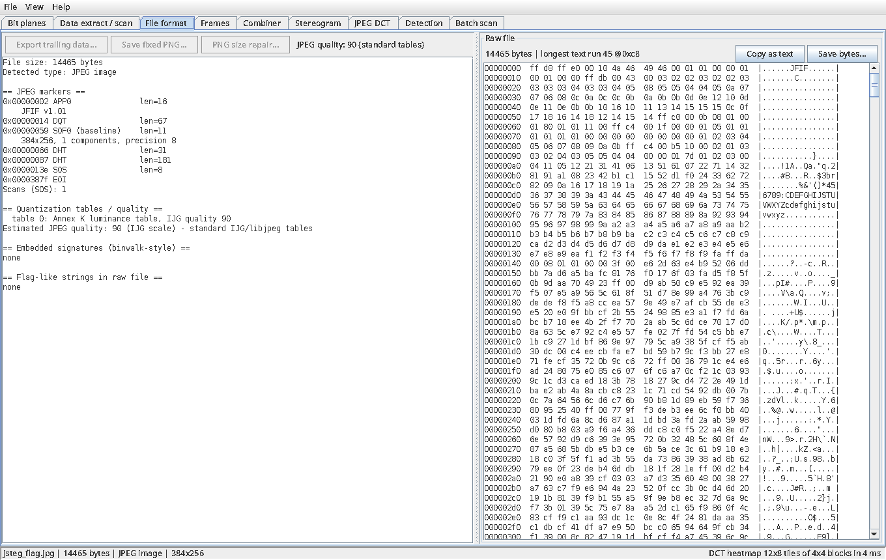

#### 4.3.1 PNG 宽高篡改的自动检测

CTF 中常见的手法是修改 IHDR 中的高度（或宽度）把图片下半部分「藏起来」。由于 IHDR 的 CRC 是对原始宽高计算的，修改后 CRC 不再匹配。File format 报告会：

1. 报告 IHDR 块 CRC 不匹配；
2. 自动在 1..20000 × 1..20000（或单边至 65535）范围内寻找与存储 CRC 匹配的宽高，找到时报告 `-> CRC matches width=... height=... (stored WxH). Use 'Save fixed PNG'.`，**Save fixed PNG...** 按钮可用；找不到时提示 CRC 可能也被改了，建议使用 **PNG size repair...** 的 IDAT size inference；
3. 比较 IDAT 解压大小与 IHDR 推算大小，不一致时警告 `IDAT size does not match IHDR width/height - the dimensions were probably changed`。

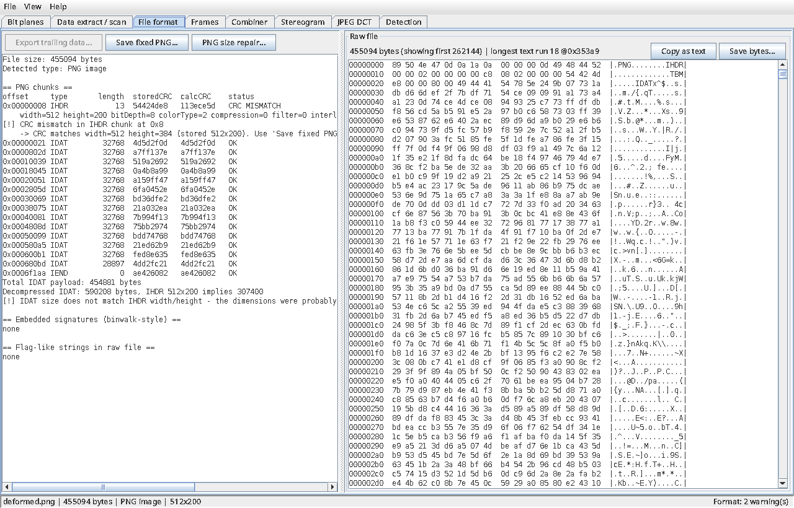

#### 4.3.2 PNG size repair... 对话框

点击 **PNG size repair...** 打开。顶部显示当前 IHDR 信息（含存储 CRC 与计算 CRC）。左侧三个模式标签页，右侧 **Preview** 实时预览所选候选尺寸的解码效果，下方 **Save repaired PNG...** 保存（文件名 `原名_repaired.png`，**IHDR 的 CRC 总是重新计算，原文件不被修改**）。

**① CRC search（CRC 搜索）**——适用于只改了宽高、没改 CRC 的情况。

- **Width from / to**、**Height from / to**：搜索范围，默认 1..20000 × 1..20000；**Threads**：线程数（默认 CPU 核数）。
- 点 **Search CRC matches**，列出所有 CRC 与存储值相等的 (Width, Height)，**Change** 列说明相对原值改了哪一项：`unchanged` / `width` / `height` / `both`。程序自动选中最可能的一项（优先只改了一个维度、且面积最接近原尺寸的结果）。最多列出 1000 个匹配，超出时提示 `(list truncated)`。
- 性能：CRC-32 在 GF(2) 上是仿射的，程序先对高度贡献建表排序，再对每个宽度查表（O(W + H log H)），返回的结果与逐一计算 4 亿个 CRC 的暴力搜索完全一致（已与朴素搜索对照验证），但在默认范围下热启动约 4–7 ms、首次调用约 50 ms（8 核，JDK 8 与 21）。作为对比，真正计算全部 4×10⁸ 个 IHDR CRC 的朴素搜索在 8 线程上约 1.0 s，单线程约 7 s（JDK 21）/ 9 s（JDK 8）。

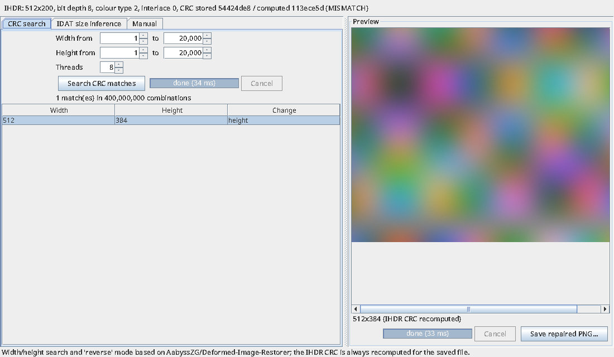

**② IDAT size inference（IDAT 大小反推）**——适用于出题人**连 CRC 也一起改了**的情况（CRC 搜索找不到或只找到原值）。

- 原理：对非隔行 PNG，解压后的 IDAT 大小必须等于 `h × (1 + ceil(w × bitsPerPixel / 8))`。点 **Infer from IDAT size**，程序枚举所有能整除该大小的行长度，得到 (宽, 高) 候选，并检查每行开头的过滤字节是否都在 0..4 之内。
- 结果表列：**Width**、**Height**、**Filter bytes**（`valid` / `not checked`）、**Note**（如 `stored width`）。保持原宽度的候选排在第一位，上方信息区还会给出 `stored width W -> height H`。

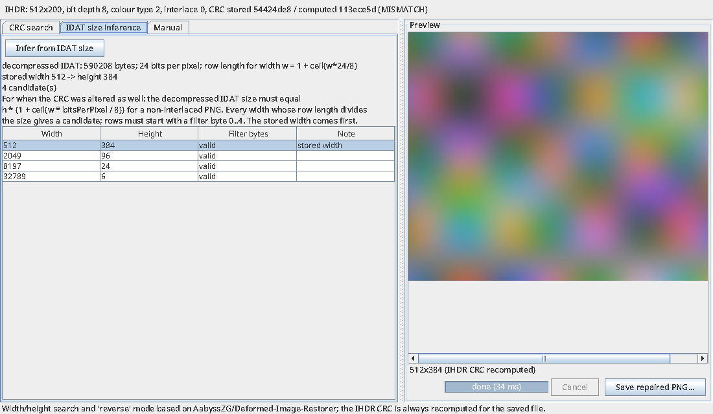

**③ Manual（手动）**——输入 **Width** / **Height**，点 **Apply (rewrite IHDR + CRC) and preview**，程序把该尺寸写入 IHDR 并重算 CRC（相当于原脚本的 reverse 模式）。在其它两个标签页选中某行时，也会自动填入这里。

> 预览上限为 4000 万像素，超过时显示 `too large to preview (can still be saved)`，仍可保存。若 JDK 解码器无法读取该尺寸，会提示 `the JDK decoder could not read this size`。

该对话框的宽高搜索与「反推」思路来自 [AabyssZG/Deformed-Image-Restorer](https://github.com/AabyssZG/Deformed-Image-Restorer)（Python），并整合进了原有的 PNG CRC 修复功能，而不是作为单独工具。

### 4.4 Frames（帧浏览）

**用途**：拆分 GIF 和 APNG 动画，逐帧查看、导出，寻找只在某一帧出现、或被后续帧覆盖的内容。

| 控件 | 说明 |
|---|---|
| 左侧帧列表 | 每行格式：`#序号  宽x高 @(x,y) 附加信息`。GIF 显示 `delay=200ms dispose=keep` 等；APNG 显示延时（分数秒）、dispose 和 blend |
| **Composite (draw over previous frames)** | 默认不勾选：**Raw 模式**，每帧单独画在空白画布上（能看到每一帧真正包含的像素）。勾选后为**合成模式**，按播放器规则渲染出实际显示的画面 |
| **Zoom:** / **Save frame...** | 缩放；保存当前帧为 `原名_frameN.png` |
| **Save all to folder...** | 选择文件夹，把所有帧保存为 `原名_frame000.png`、`原名_frame001.png` … |

合成模式遵循的规则：

- **GIF**：disposal `none` / `keep`、`restoreToBackground`（把帧区域清为透明，与浏览器一致）、`restoreToPrevious`；
- **APNG**：`dispose_op` NONE / BACKGROUND / PREVIOUS（第一帧的 PREVIOUS 按 BACKGROUND 处理），`blend_op` SOURCE / OVER。

不是动画的文件会显示为单帧（`single image`；无 `acTL` 的 PNG 显示 `static PNG (no acTL)`）。

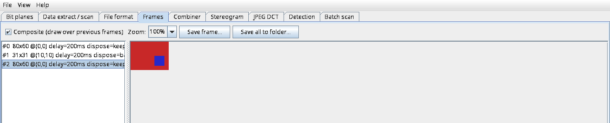

**技巧**：flag 常被拆成多帧、或只在某一帧闪现、或藏在极短延时的帧里。先用 Raw 模式逐帧看，再用 Composite 看合成效果；帧数多时直接 **Save all to folder...**，再配合 Combiner 对两帧做 XOR。

### 4.5 Combiner（图像合成）

**用途**：把当前打开的图像（A）与另一张图像（B）逐像素运算，常用于「两张看似相同的图」、「图与原图比对」、「两帧异或」类题目。

| 控件 | 说明 |
|---|---|
| `A = current file` | A 固定为当前打开的文件 |
| **Choose image B...** | 选择第二张图；右侧显示 `Image B: 文件名 (宽x高)` |
| 运算下拉框 | `XOR`、`OR`、`AND`、`ADD (mod 256)`、`SUB (A-B mod 256)`、`SUB \|A-B\|`、`LIGHTEST`（取较大值）、`DARKEST`（取较小值）、`Interlace rows (A,B,A,B...)`（偶数行取 A、奇数行取 B）、`Interlace columns`（按列交错） |
| **Zoom:** / **Save result...** | 缩放；保存结果为 `原名_combined_运算名.png` |

说明：运算按 R、G、B 三个通道分别进行，结果不透明（Alpha 固定为 255）；交错模式直接取原像素。两图尺寸不同时，结果取两者重叠的左上角区域（宽高取较小值）。未选择 B 时显示 A 原图。

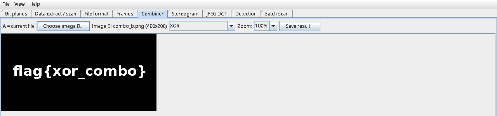

### 4.6 Stereogram（立体图求解）

**用途**：求解自动立体图（随机点立体图、「魔眼图」）。每个像素与其右侧 `offset` 列处的像素（超出右边界则回绕）比较；当 offset 等于图案的重复宽度时，隐藏的形状就会显现。

| 控件 | 说明 |
|---|---|
| **< Prev** / 滑块 / **Next >** | 调整偏移量，范围 0 到图宽 − 1；**Alt+Left / Alt+Right** 每次 ±1（循环） |
| `Offset: N / W` | 当前偏移 / 图宽 |
| 模式下拉框 | `XOR (Stegsolve)`（与 Stegsolve 相同的异或）或 `Absolute difference`（逐通道差的绝对值，噪声较少时更干净） |
| **Zoom:** / **Save view...** | 缩放；保存为 `原名_stereo_xor_offN.png` |

可用 `-Dstegsuite.stereoOffset=N` 设置打开文件时的初始偏移。

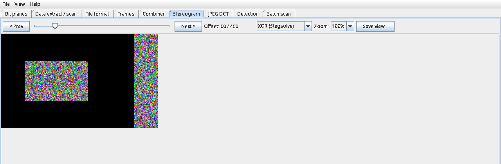

**技巧**：按住 Alt 连按右方向键从 0 往上扫，图像会从一片噪声逐渐变成清晰形状；重复宽度通常在图宽的 1/10 到 1/5 之间（例如 400 宽的示例图为 60）。

### 4.7 JPEG DCT（JPEG 系数域分析）

**用途**：JPEG 是有损格式，隐写数据通常藏在**量化后的 DCT 系数**中（JSteg、F5、OutGuess 等），像素层面的 LSB 分析对它没有意义。StegSuite 内置插件 `DCT coefficients / JSteg`（类 `org.stegsuite.plugin.dct.JpegDctPlugin`）自行解码熵编码的 DCT 系数（baseline / extended sequential / progressive Huffman、restart 标记，自带反 DCT 与 libjpeg 兼容的色度上采样），并提供分析与提取。

只有打开 JPEG 文件时按钮才可用；否则报告区显示 *The open file is not a JPEG - the DCT tools only work on JPEG files.*

**顶部控件**

| 控件 | 说明 |
|---|---|
| **Plugin:** | 选择插件（内置为 `DCT coefficients / JSteg`；可扩展，见 4.7.6） |
| **Key (custom order):** | 可选密钥，启用一种**StegSuite 自定义的**带密钥系数位置置换。**它与 F5 / OutGuess 的密码不兼容**，填入这些工具的密码不会得到它们的数据 |
| **Analyze** | 解码系数并生成完整分析报告、卡方攻击曲线和块热力图 |
| **Extract** | 提取最佳载荷，显示在下方 **Extracted bytes** 十六进制区 |
| **Full cross-check** | Analyze 之后可用：用 JDK 解码器对**整幅图**做交叉校验（默认只比较前 256 行） |
| 进度条 + **Cancel** | 所有 DCT 计算都在后台运行，可取消 |

下方有三个子标签页：**Report**、**Chi-square attack**、**Block heatmap**。

#### 4.7.1 Report（分析报告）

报告分为可折叠的章节（点击标题展开/折叠；**Expand all** / **Collapse all** 一键全部展开/折叠），主要内容：

- **JPEG DCT analysis**：帧类型、分量、采样因子、量化表（含每张表的 IJG 质量估计）、Huffman 表结构、restart 间隔；本节附带**每张量化表的 8×8 热力图**（格子颜色越深步长越大，并标注质量估计）。
- **DCT coefficients**：每个分量的有符号系数直方图、零/非零比例、JSteg 容量；本节附带**系数直方图图表**（非零 AC 值 −12..12，灰色带标出卡方检验比较的幅度值对）。
- **Steganalysis (DCT domain)**：
  - Westfeld / Pfitzmann 卡方检验：对系数值对 {|v| = 2i, 2i+1}（幅度对，保留符号）以及二进制补码值对（原版 JSteg）分别计算 chi2/df 和 p 值；**chi2/df 接近 1 表示直方图与「随机 LSB 已嵌入」一致**。同时给出移位后的对照值对 (2i+1, 2i+2)，若对照也很「平」，说明直方图本身就平坦，结论不确定。
  - LSB 奇偶平衡：只统计 LSB 替换实际会改动的系数（|v| > 1）。
  - 前段窗口变体：提示可能存在短的顺序载荷。
  - F5 形状检查与**校准（Calibration）**：按 Fridrich、Goljan、Hogea 方法，将图像裁掉 4 像素后用相同亮度量化表重新压缩，从 (0,1)、(1,0)、(1,1) 模式估计 F5 收缩率 β（对系数数 ≥ 50 的模式做合并最小二乘）。**β > 0.10 被标记**为 F5 迹象。实测：干净 JPEG（质量 50–90）|β| < 0.07；模拟 F5 收缩 0.1 / 0.25 / 0.5 时估计约 0.10–0.15 / 0.30–0.32 / 0.63–0.68（高嵌入率时偏高）。
- 各提取布局找到的载荷（含偏移）、把载荷和直方图指标放在一起的**汇总结论**。
- **Decoder cross-check**：本程序的反 DCT 与 JDK JPEG 解码器的对比（默认前 256 行，24 MP 图约 25 ms；**Full cross-check** 比较全图，约 0.4 s）。

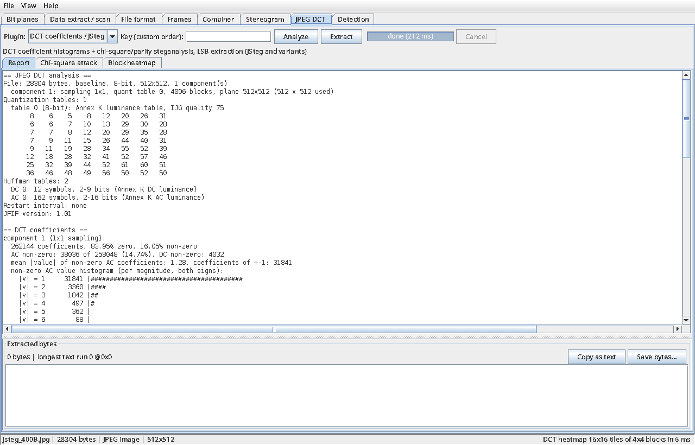

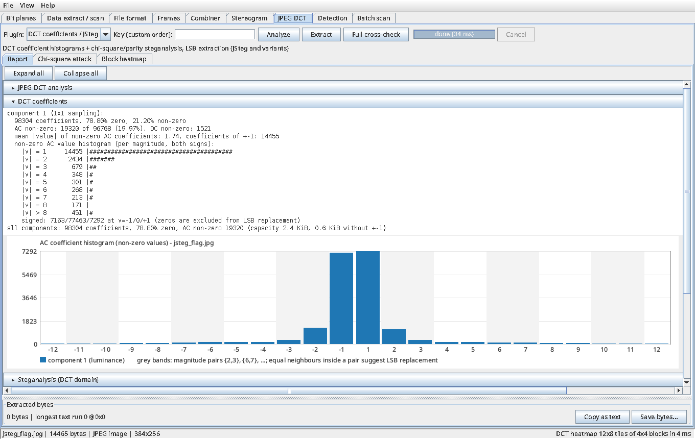

#### 4.7.2 Chi-square attack（卡方攻击曲线）

Westfeld & Pfitzmann 卡方攻击：按 JSteg 读取顺序，对前 1%…100% 的非零 AC 系数（200 步）计算值对检验的 p 值，分别画出**二进制补码值对**（原版 JSteg）和**幅度值对**（保留符号）两条曲线。

- **怎么读**：顺序嵌入的载荷会让曲线在载荷结束前保持明显大于 0 的 p 值（理想情况下接近 1，实际图像中常在 0.2–0.8 之间波动，见下图），然后骤降到 0。程序用 sqrt(chi − df) 的线性拟合细化估计的结束位置（阴影区域）和载荷字节数。
- 只有当同一前缀上的移位对照值对保持自然、且全图统计功效足够时，才会报告估计长度。示例：400 字节 JSteg 载荷 → 估计约 381 字节。
- **F5、OutGuess 等分散/带密钥嵌入不会产生这种骤降**，曲线平坦为 0 并不代表没有隐写。

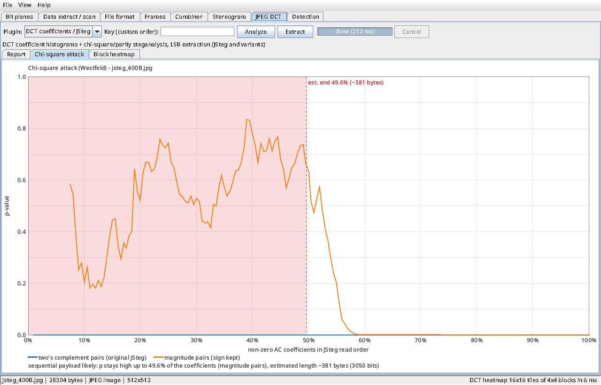

#### 4.7.3 Block heatmap（块热力图）

在图像上叠加亮度分量系数值对的分块卡方 p 值，并画出 8×8 块网格：

- **Show heatmap**（默认勾选）；**tile (8x8 blocks):** 每格包含 1 / 2 / 4（默认）/ 8 / 16 个 8×8 块；**opacity** 透明度；**Zoom:**。
- 红色 = 系数值对被拉平（p 高）；蓝色 = 自然直方图；无颜色 = 系数太少。悬停显示该格 p 值。
- 需要先 **Analyze**。

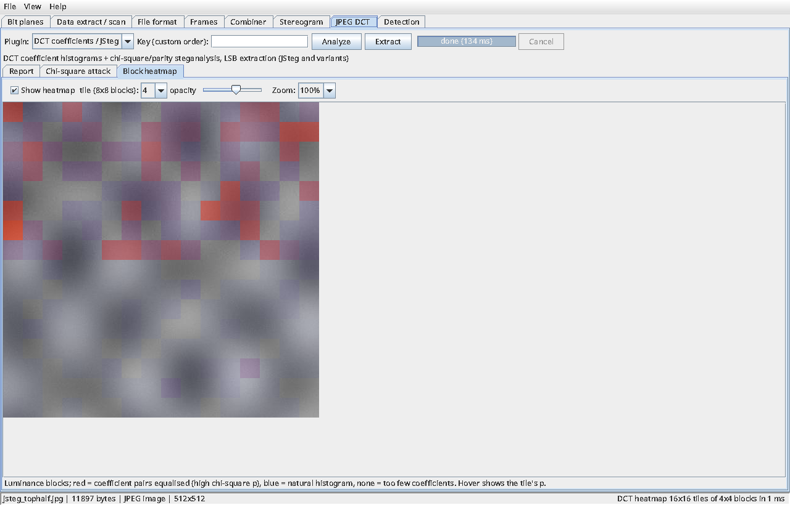

#### 4.7.4 Extract（提取）与提取布局

**Extract** 返回各布局中找到的最佳载荷（在任意偏移搜索 flag、文件头和自然文本，排序规则与位平面自动扫描相同）；如果什么都没识别出来，则返回原始的 JSteg LSB 流。报告区会显示 `Extracted N bytes from ... (key used/not used)` 和前若干字节的预览；无结果时提示 *No payload found*。

内置的提取布局（报告中的名称）：

| 布局 | 说明 |
|---|---|
| `JSteg: LSB of non-zero AC coefficients, zig-zag order` | 所有分量、非零 AC 系数的 LSB，zig-zag 顺序 |
| `JSteg original: AC coefficients except 0 and +1, zig-zag order` | 原版 JSteg（Derek Upham）的规则：跳过 0 和 +1 |
| `JSteg original with length header (exact payload)` | 解析原版 JSteg 的长度头（5 位「长度的位数」+ 长度，MSB 在前），合理时把载荷精确截取到该长度；列表中显示为 "JSteg header" |
| `JSteg (first component only)` | 只用第一个分量（亮度） |
| `JSteg variant: AC coefficients except 0 and +-1` | 跳过 \|v\| ≤ 1，与参考实现 `jsteg.c` 一致 |
| `LSB of all non-zero coefficients (DC included)` | 包含 DC 系数 |
| `LSB of every coefficient (zeros and DC included)` | 包含零系数和 DC |
| `LSB of non-zero AC coefficients, raster (non zig-zag) order` | 光栅顺序而非 zig-zag |
| `custom order (not compatible with F5/OutGuess)` | 填写 Key 时额外尝试的 StegSuite 自定义带密钥置换 |

> 再次强调：**Key (custom order) 不是 F5/OutGuess 的密码输入框**。StegSuite 目前不能提取 F5、OutGuess、steghide 的数据，只能通过校准 β、直方图等指标**提示**可能存在 F5 类嵌入，需要用对应的原工具配合密码提取。

#### 4.7.5 性能与缓存

每个打开的文件只解码一次：解码出的系数和重建预览缓存在 `DctImageCache` 中（保留最近 2 个文件），Analyze、Extract、图表和块热力图共享。Huffman 解码使用 9 位查找表，反 DCT 使用 AAN 浮点算法（libjpeg `jidctflt`），校准和各提取布局并行运行。参考数据：6000×4000、质量 85 的 JPEG（4.3 MB），Analyze + 预览，冷缓存，8 核：JDK 21 首次 2.1 s、热启动 1.2–1.6 s；JDK 8 首次 2.1 s、热启动 1.7–1.8 s。

#### 4.7.6 扩展插件

JPEG DCT 标签页是一个扩展点。实现接口 `org.stegsuite.plugin.JpegStegoPlugin`：

```java
public interface JpegStegoPlugin {
    String name();
    default String description() { return ""; }
    String analyze(byte[] jpegBytes) throws Exception;                 // 报告文本
    byte[] extract(byte[] jpegBytes, String password) throws Exception; // 载荷或 null
}
```

在 `META-INF/services/org.stegsuite.plugin.JpegStegoPlugin` 中登记实现类，然后用
`java -cp stegsuite-1.0.0-all.jar:plugin.jar org.stegsuite.Main` 启动，即可在 **Plugin:** 下拉框中选择。报告文本中形如 `== 标题 ==` 的行会被切分为可折叠章节。

### 4.8 Detection（RS + SPA 检测）

**用途**：对无损图像（PNG、BMP 等）估计每个颜色通道的 **LSB 替换嵌入率**。

点击 **Run RS + SPA**（后台运行，可取消）。使用两种经典方法：

- **RS 分析**（Fridrich、Goljan、Du 2001；掩码 0110，水平 + 垂直分组）；
- **SPA 样本对分析**（Dumitrescu、Wu、Wang 2003）。

**结果表**列：**Channel**（R/G/B；若 R=G=B 则只有一行 `gray`）、**RS estimate**、**SPA estimate**、**Mean**，以及 RS 分组计数 **R_M**、**S_M**、**R_-M**、**S_-M**、**R_M (flipped)**、**S_M (flipped)**。估计值 ≥ 10% 时以红色显示。

**结论行**（加粗）：当某通道两种估计都高于 10% 时，以红色给出 `LSB replacement likely ...`，否则为绿色。下方文本区给出详细数值（原始估计、分组数、样本对数等）和警告：JPEG/有损文件、调色板图像（基于调色板 RGB 值计算）、过小的图像（小于约 64×64 时估计噪声很大）。

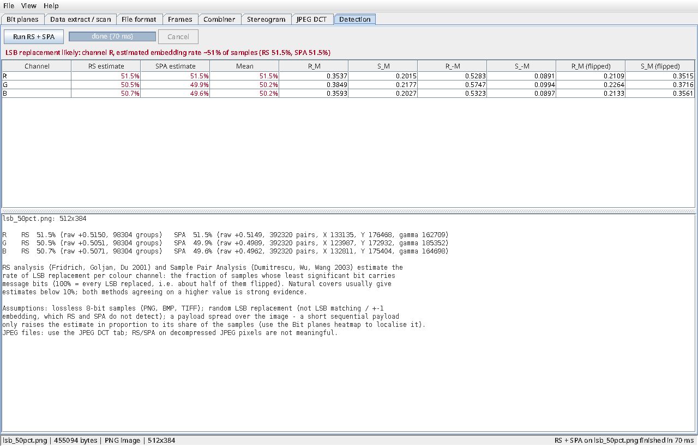

**嵌入率的含义**：100% 表示每个样本的 LSB 都承载了消息位（其中约一半实际被翻转）。自然载体通常低于 10%。

**准确度**（合成的 512×512 载体）：嵌入率 0–75% 时误差约 ±3 个百分点，100% 时估计为 0.94–1.0（测试用例的要求：0/25/50% 时 ±6 个百分点，100% 时 > 0.9）。

**适用前提与局限**：

- 只测量 LSB **替换**；**LSB 匹配（±1 嵌入）检测不到**。
- 要求载荷分散在整幅图上；**短的顺序载荷只会按其占比抬高估计值**（例如只写了前 5% 的像素，估计就只有约 5%）——此时请用 Bit planes 的 LSB 热力图定位。
- JPEG 文件请使用 JPEG DCT 标签页；在 JPEG 解压后的像素上做 RS/SPA 没有意义。

### 4.9 Batch scan（批量扫描）

见第 5 章。

## 5 批量扫描与报告导出

### 5.1 Batch scan 标签页

通过标签页 8 或 **File > Batch scan folder...**（Ctrl+B）进入。

| 控件 | 说明 |
|---|---|
| **Folder:** + **Browse...** | 要扫描的文件夹（打开过文件后，默认填入该文件所在目录） |
| **Recursive** | 是否递归子文件夹（默认勾选） |
| **Types:** PNG / JPEG / BMP / GIF / Other | 要包含的类型，**按内容识别**而非扩展名；Other 默认不勾选，其它文件只做格式分析（附加数据、内嵌签名、flag 字符串） |
| **Quick auto scan** | 是否对每个无损图像跑 QUICK 自动扫描（默认勾选；大图会较慢） |
| **Scan folder** | 开始扫描（后台运行，带进度条和 Cancel） |
| **Export batch report...** | 导出批量报告 |

扫描时文件逐个完成并实时加入表格，结束后按分数降序排序（点击表头可重新排序），右侧摘要显示 `N files, M with score >= 60`。**单击**一行，下方详情区显示该文件的各项指标；**双击**一行，在主窗口其它标签页中打开该文件继续分析。

表格列：**File**（相对路径）、**Type**、**Size**、**Score**（≥ 60 红底，≥ 30 黄底）、**Level**、**Findings**（各指标及加分）、**Scan hit**（最佳自动扫描命中）、**DCT**（JPEG 的 DCT 结论与质量）、**RS/SPA %**（最大通道的估计嵌入率）、**ms**（耗时）。

每个文件分析的内容：

- 格式警告：CRC 错误、IDAT 大小与 IHDR 不符、非标准块、附加数据、与文件类型不同的或位于结束标记之后的内嵌签名、原始字节中的 flag 字符串；
- QUICK 自动扫描命中（无损图像）；
- JPEG：DCT 结论（各提取布局找到的载荷、直方图/值对结论、卡方攻击估计长度、校准 β），质量显示在 DCT 列；
- PNG/BMP（以及 GIF）：RS/SPA 嵌入率估计（取最大的通道）。

**限制**：超过 256 MiB 的文件跳过；超过 5000 万像素的图像跳过自动扫描和 RS/SPA。文件是一个接一个分析的（每个文件内部是并行的）。

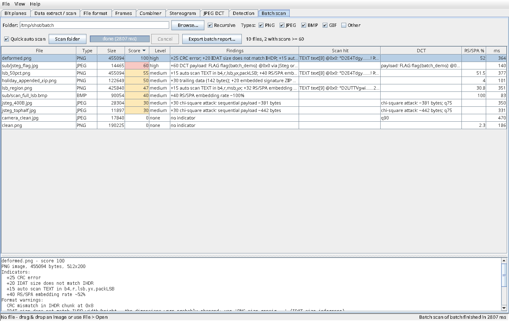

### 5.2 可疑度分数（Suspicion score）

分数范围 0–100，是各项指标固定权重之和（上限 100）。**它是排序辅助，不是概率**——用于决定先人工检查哪些文件。

| 指标 | 权重 |
|---|---|
| 结束标记后有附加数据 | 30 |
| 内嵌文件签名 | 20 |
| 原始字节中出现 flag 字符串 | 40 |
| PNG CRC 错误 / IDAT 大小不符 / 非标准块 / 其它警告 | 25 / 20 / 10 / 5 |
| 自动扫描最佳命中为 FLAG / FILE / TEXT | 50 / 35 / 15 |
| DCT 载荷：flag / 强 / 弱 | 60 / 40 / 20 |
| DCT 值对被拉平（类 JSteg）/ 弱迹象 | 30 / 10 |
| 卡方攻击发现顺序载荷 | 30 |
| 校准 β > 0.10（类 F5） | 25 |
| RS/SPA 嵌入率 r ≥ 10% | min(40, 20 + 40r) |

**等级（Level）**：`high` ≥ 60，`medium` ≥ 30，`low` > 0，`none` = 0。

解读建议：

- **high** 通常意味着有直接证据（flag、明确的载荷、附加数据 + 内嵌文件）；
- **medium** 值得逐个打开查看；
- **low** 里最常见的是噪声/合成图上的弱 TEXT 命中（+15），多为误报；
- 分数为 0 也不代表干净：LSB 匹配、带密钥或分散的 JPEG 嵌入（小载荷）都可能拿到 0 分。

### 5.3 单文件报告：File > Export report...（Ctrl+E）

先打开一个文件，再按 Ctrl+E。对话框选项：

- **Quick auto scan (bit-plane LSB layouts)**（默认勾选）：报告中包含 QUICK 自动扫描；
- **Full decoder cross-check (JPEG; default: first rows)**（仅 JPEG 可用）：对全图做解码交叉校验。

点 **Export...** 选择保存位置，**格式由扩展名决定**（.html / .md / .json；文件选择框也提供三种过滤器，未写扩展名时按所选过滤器补全）。分析在后台进行（可 Cancel），完成后显示 `Written: 路径`。

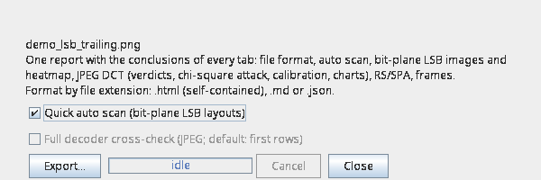

报告汇集所有标签页的结论：摘要与分数、位平面图与 LSB 热力图、File format 报告、自动扫描、JPEG DCT 报告（含卡方攻击、系数直方图、量化表热力图）、RS/SPA、帧数。

| 格式 | 特点 |
|---|---|
| **HTML** | 单个自包含文件：图表和缩略图以 base64 PNG 内嵌；章节使用 `<details>`，无需 JavaScript 即可折叠；批量报告的表格可排序（一小段内联脚本） |
| **Markdown** | 相同的文本章节，**不含图片**（报告中会注明） |
| **JSON** | 机器可读：标题、分数、等级、摘要、发现项、批量表格，以及嵌套的章节及其数据字段（图片只保留标题说明） |

示例：`samples/report_example.html` 是一个含 JSteg flag 的 JPEG 的导出报告——分数 60/100（high），发现项为 `+60 DCT payload: FLAG flag{batch_demo} @0x0 via JSteg original with length header (exact payload)`。

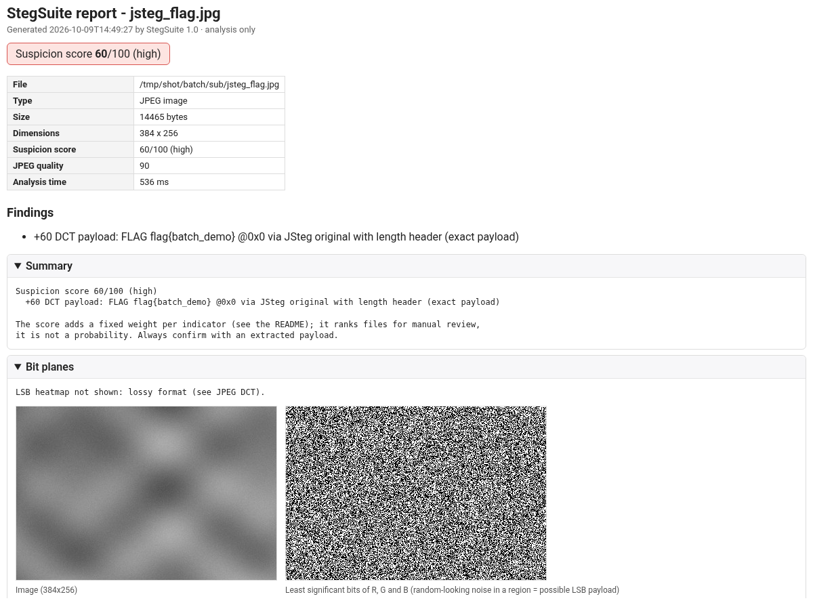

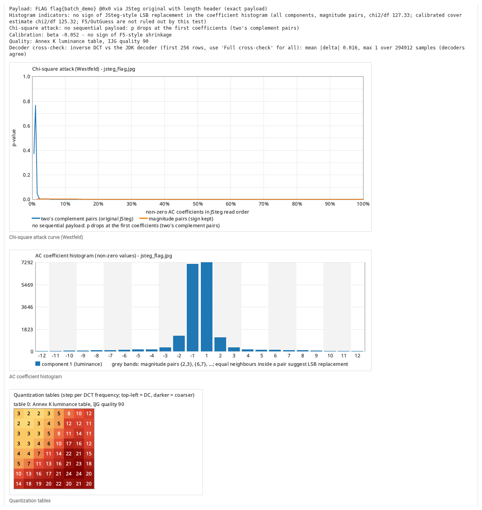

### 5.4 批量报告

在 Batch scan 中点 **Export batch report...**（或菜单 **File > Export batch report...**），默认文件名 `batch_report_文件夹名.html`。HTML 版包含带缩略图的汇总表格，以及每个文件一个折叠章节。

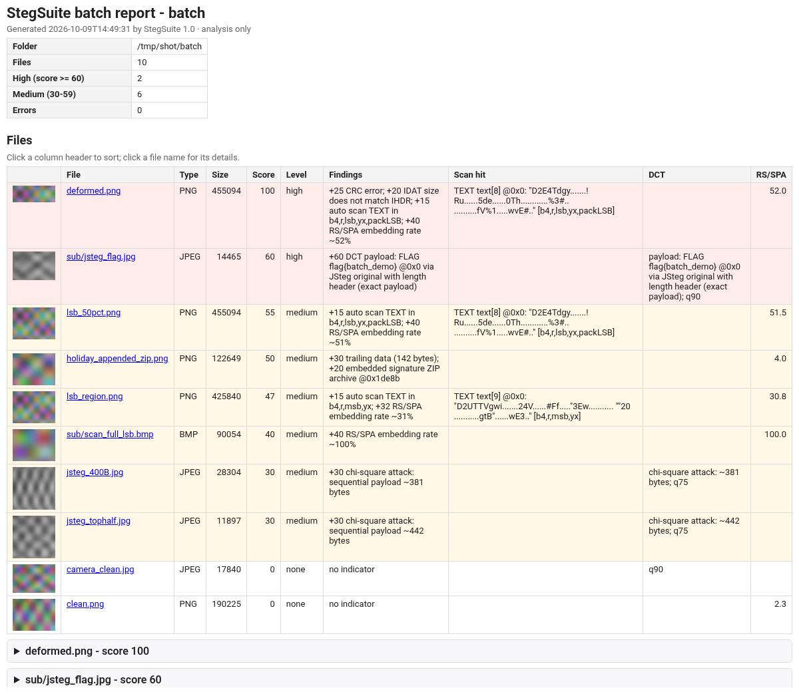

## 6 典型 CTF 解题流程

以下流程都以「拖入题目文件」开始。拿到未知图片时，建议的通用顺序是：**File format →  Data extract（QUICK）→ Bit planes → 视格式选择 Frames / JPEG DCT / Detection → Ctrl+E 导出报告留档**。

### 6.1 PNG 宽高被修改（图片显示不全）

**现象**：图片下半部分「消失」，或 File format 报告 IHDR `CRC mismatch`、`IDAT size does not match IHDR width/height`。

1. 打开 PNG，切到 **File format**（`--tab 2`）。
2. 查看 IHDR 行：若存储 CRC 与计算 CRC 不同，报告中会直接给出匹配的宽高，**Save fixed PNG...** 可用——直接保存即可。
3. 想确认或有多个候选时，点 **PNG size repair...** → **CRC search** → **Search CRC matches**，在右侧预览中逐个检查。
4. 若 CRC search 只找到 `unchanged`（说明出题人连 CRC 也改了）→ 切到 **IDAT size inference** → **Infer from IDAT size**，通常第一个候选（`stored width`）就是正确高度。
5. 仍不对时，在 **Manual** 中手动输入宽高并预览。
6. **Save repaired PNG...** 保存后，把修复的图再拖入 StegSuite 继续分析（修复后的图本身可能还有其它隐写）。

### 6.2 LSB 隐藏 flag

1. 打开图片，切到 **Data extract / scan**（`--tab 1`），选 **QUICK**，点 **Auto scan**。
2. 结果表首行若为 `FLAG`，Detail 中就是 flag；单击加载配置，点 **Preview / extract** 看上下文。
3. 若只有 `TEXT` / `FILE`：双击查看数据，FILE 命中可直接 **Save bytes...** 保存为对应格式。
4. 没有结果时：换 **DEEP** 再扫；去 **Bit planes** 用 Alt+Right 逐个看位平面，注意 Alpha 通道和高位平面；勾选 **LSB heatmap** 看嵌入区域；在 **Detection** 跑 **Run RS + SPA** 判断是否存在全图 LSB 替换。
5. 若位平面里能看到图案但自动扫描无果，可能是非常规顺序（如 BGR、逐列、按 LSB 打包），在手动区组合尝试；也可能数据本身经过加密/压缩，需要题目给的其它线索。

### 6.3 文件尾附加压缩包

**现象**：图片能正常显示，但文件大小明显偏大。

1. 打开文件，切到 **File format**。
2. 若报告出现 `[!] N bytes of trailing data after end marker at offset 0x...`，点 **Export trailing data...** 保存附加数据。
3. 查看 `== Embedded signatures (binwalk-style) ==` 部分：若列出了 `ZIP archive`、`RAR archive`、`7-Zip archive` 等及其偏移，即附加的压缩包；保存出来后改扩展名解压。
4. 同时看 `== Flag-like strings in raw file ==`：有些题目直接把 flag 明文附在文件尾。
5. 压缩包有密码时，回头检查 PNG 的 `tEXt`/`zTXt` 文本块、JPEG 的 `COMMENT` 和 EXIF 字段（Artist、Copyright 等）——密码常放在这里。

### 6.4 GIF 帧隐藏

1. 打开 GIF，切到 **Frames**（`--tab 3`）。
2. 不勾选 Composite（Raw 模式）逐帧点击，查看每帧实际包含的内容和 `@(x,y)` 位置；特别留意尺寸很小的帧、`delay` 极短的帧。
3. 勾选 **Composite** 看播放器实际显示的画面，对比 Raw 与 Composite 的差异（被后续帧覆盖的内容）。
4. **Save all to folder...** 导出全部帧；需要比较两帧时，打开其中一帧，到 **Combiner** 选另一帧做 `XOR` 或 `SUB |A-B|`。
5. 别忘了 **File format** 中 GIF 的 `COMMENT` 扩展和附加数据；每帧导出后还可以分别做位平面分析。
6. 延时序列本身也可能编码信息（如长短延时对应摩尔斯码/二进制），帧列表中的 `delay=` 可以直接读出。

### 6.5 JPEG JSteg 隐写

1. 打开 JPEG，切到 **JPEG DCT**（`--tab 6`），点 **Analyze**。
2. 在 **Report** 的汇总中查看 `Payload:` 行——若某个布局在某偏移处找到 FLAG / 文件头 / 文本，会直接列出（如 `FLAG flag{...} @0x0 via JSteg original with length header (exact payload)`）。
3. 点 **Extract** 获取最佳载荷，在 **Extracted bytes** 中查看或 **Save bytes...**。
4. 看 **Chi-square attack** 曲线：p 值先高后骤降，说明有顺序嵌入，阴影结束处给出估计长度。
5. **Block heatmap** 可看出嵌入集中在哪些区域。
6. 若卡方攻击平坦但校准 β > 0.10，或 F5 形状检查异常，可能是 **F5**；若怀疑 OutGuess / steghide，StegSuite 无法提取，请用对应工具（如 stegseek、outguess、F5 的 Java 实现）配合密码或字典。**不要把这些工具的密码填进 Key (custom order)。**
7. 别忘了 JPEG 也可能只是简单的 EOI 后附加数据或 EXIF 注释——先看 **File format**。

### 6.6 立体图（魔眼图）

1. 打开图片（一般是彩色随机点或重复花纹），切到 **Stereogram**（`--tab 5`）。
2. 按 **Alt+Right** 从小到大扫描偏移，或拖动滑块；接近重复宽度时会出现轮廓，在附近 ±1 微调到最清晰。
3. 若 XOR 结果噪声较大，切换到 `Absolute difference`。
4. **Save view...** 保存结果；文字可能是镜像或很淡，可以在 Bit planes 中对保存的结果再做 `Invert result` 或位平面处理。
5. 示例：`samples/demo_stereogram.png` 的周期为 60（`-Dstegsuite.stereoOffset=60` 可直接定位）。

### 6.7 两张相似图片（异或 / 差分）

题目给出两张看起来一样的图（或一张图 + 它的原图）：打开第一张，切到 **Combiner**，**Choose image B...** 选第二张，依次尝试 `XOR`、`SUB |A-B|`；差异处会显现文字或图案。必要时把结果 **Save result...** 后再拖入 StegSuite 做位平面分析。

### 6.8 一大堆图片里找出有问题的那张

有些取证题给出几十上百张图。按 **Ctrl+B** 选择文件夹并 **Scan folder**，扫描完成后按分数排序，从 high 开始逐个**双击**打开分析；最后 **Export batch report...** 留档。

## 7 快捷键一览

| 快捷键 | 作用 | 作用范围 |
|---|---|---|
| **Ctrl+O** | File > Open... 打开文件 | 全局 |
| **Ctrl+E** | File > Export report... 导出当前文件报告 | 全局（需已打开文件） |
| **Ctrl+B** | File > Batch scan folder... 批量扫描文件夹 | 全局 |
| **Alt+Left** | 上一个视图 | Bit planes 标签页 |
| **Alt+Right** | 下一个视图 | Bit planes 标签页 |
| **Alt+Left** | 偏移量 −1 | Stereogram 标签页 |
| **Alt+Right** | 偏移量 +1 | Stereogram 标签页 |
| 鼠标悬停 | 状态栏显示像素坐标、ARGB、热力图 p 值 | 所有图像视图 |
| 单击 / 双击结果行 | 加载配置 / 打开数据窗口 | Data extract / scan 结果表 |
| 双击文件行 | 在主窗口打开该文件 | Batch scan 表格 |
| 拖放文件 | 打开文件 | 窗口任意位置 |

> macOS 上 Ctrl 为 Cmd。Alt+方向键只在对应标签页处于显示状态时生效，因此两个标签页使用相同按键不会冲突。

## 8 常见问题 FAQ

**Q1：在 Java 8 上字体和按钮特别小，怎么办？**  
Java 8 不支持 HiDPI 自动缩放。StegSuite 默认会按屏幕 DPI 自动放大（Auto），但有些系统报告的 DPI 不准确。可以：① **View > UI scale** 选 150% 或 200%，然后**重启**程序；② 或在命令行加 `-Dstegsuite.scale=1.5`（优先级最高）。可在 **Help > About** 确认当前倍数和来源。Java 9+ 由 JVM 自行缩放，Auto 为 100%，通常不需要设置；若仍想放大，显式值会叠加在 JVM 缩放之上。

**Q2：修改了 UI scale 却没有变化？**  
该设置需要重启后生效。另外，如果启动命令中带了 `-Dstegsuite.scale`，它会覆盖菜单设置（提示框中会注明）。

**Q3：自动扫描出现很多 TEXT 命中，内容像乱码，是误报吗？**  
多半是。噪声大的照片或程序生成的合成图，其低位中会偶然出现较长的「类单词」可打印串。程序已过滤渐变/纯色区域产生的重复串，并把 TEXT 排在 FLAG 和 FILE 之后，但无法完全避免。判断方法：双击查看内容是否有意义；看 Bit planes 中对应平面是否真有异常区域；在批量扫描中这类命中只加 15 分（low）。FILE 命中也可能偶然出现，偏移不为 0 的签名已要求头部字段合理以降低误报，但仍需打开确认。

**Q4：LSB 热力图在照片上到处是红块？**  
热力图基于值对卡方检验，噪声大的照片自然会有部分块的值对接近相等。热力图在平滑、大面积纯色的载体上最可靠。成片、边界规整（如左上角矩形、上半部分）的红色区域才是强信号。

**Q5：Detection 显示 0% 左右，但我确定图里有 LSB 数据？**  
可能原因：① 数据是**顺序写入的短载荷**，RS/SPA 的估计只按占比升高（例如 1% 的像素→约 1%）；② 使用的是 **LSB 匹配（±1）**，RS/SPA 检测不到；③ 是调色板图像或 JPEG。请改用 Data extract 自动扫描和 Bit planes 热力图。

**Q6：能提取 F5 / OutGuess / steghide 的数据吗？Key 框能填它们的密码吗？**  
不能。**Key (custom order)** 只用于 StegSuite 自定义的带密钥系数置换，**与 F5/OutGuess 的密码不兼容**。StegSuite 能做的是给出迹象：校准 β > 0.10 提示 F5 式收缩；卡方攻击对 F5、OutGuess 这类分散/带密钥嵌入不会出现骤降。确认可疑后请使用对应的原工具配合密码或字典提取。

**Q7：JPEG DCT 报告 unsupported？**  
算术编码 JPEG、12 位精度 JPEG 以及 CMYK/YCCK 布局不受支持，程序会明确报告而不是给出猜测结果。这类文件仍可在 File format 中分析结构、附加数据和元数据。

**Q8：大图片很慢或内存不足？**  
- 打开文件时整个文件会读入内存并解码为 ARGB，超大图片需要增大堆：`java -Xmx4g -jar stegsuite-1.0.0-all.jar`。内存不足时会提示 `Out of memory - the file is too large for the available heap (try -Xmx).`
- 十六进制视图只显示前 256 KiB（保存不受限）。
- 自动扫描每个组合提取 256 KiB（QUICK）/ 512 KiB（DEEP），手动提取默认上限 1024 KiB（**Max KiB** 可调）。
- PNG size repair 预览上限 4000 万像素（超出仍可保存）。
- 批量扫描跳过 > 256 MiB 的文件，> 5000 万像素的图像跳过自动扫描和 RS/SPA。
- JPEG DCT 缓存最近 2 个文件；6000×4000 的 JPEG Analyze 约 1.2–2.1 s（8 核）。

**Q9：打开的文件不是图片，为什么大部分标签页空白？**  
无法解码为图像时（状态栏 `not decodable as image`），只有 File format（签名搜索、flag 搜索、十六进制）和批量扫描中的格式分析有意义。

**Q10：为什么某个 PNG 的 IDAT 大小检查没有报告？**  
IDAT 大小检查只针对非隔行（interlace=0）的 PNG；隔行 PNG 不做该检查，IDAT size inference 同理。

**Q11：Save fixed PNG... 和 PNG size repair 的 Save repaired PNG... 有什么区别？**  
前者直接使用报告中自动爆破得到的、CRC 匹配的尺寸；后者保存对话框中当前选中/手动输入的候选尺寸，并重新计算 IHDR CRC。两者都不修改原文件。

**Q12：StegSuite 能用来给图片加隐写吗？**  
不能。StegSuite 是纯分析工具，没有任何嵌入功能。

## 9 已知限制

- **可疑度分数是启发式加权和**，用于排序和筛选，存在误报（例如噪声/合成图上的弱 TEXT 命中，+15）和漏报（LSB 匹配、带密钥或分散的小载荷 JPEG 嵌入）。
- **批量扫描逐个分析文件**（每个文件内部的分析是并行的）。
- **Markdown 报告不含图片；JSON 只保留图片标题。**
- **解码交叉校验默认只覆盖前 256 行**，需要全图时用 **Full cross-check** 或导出报告时勾选对应选项。
- **DCT 缓存只保留最近 2 个文件。**
- **RS / SPA** 只测量 LSB 替换；LSB 匹配（±1）和短的顺序载荷（估计值按占比缩小）无法可靠检测；JPEG、调色板图和过小图像的结果不可靠。
- **JPEG 指标只是迹象，不是证明**：卡方、奇偶性、校准的数值在强降噪或噪声大的图片上也可能显得「被拉平」，请始终用 Extract 找到的载荷确认。
- **卡方攻击**需要顺序载荷和足够多的系数；F5、OutGuess 等分散/带密钥嵌入不会产生曲线骤降。
- **校准**使用 Annex K Huffman 表并只考虑亮度分量，高嵌入率时 β 会偏高。
- **JSteg 长度头没有魔数**，随机数据流偶尔也会看起来像合理的长度头。
- **不支持**算术编码、12 位、CMYK/YCCK 的 JPEG 的 DCT 分析；不能提取 F5 / OutGuess / steghide 数据。
- **LSB 热力图**在噪声大的照片上会出现零散红块。
- IDAT 大小相关的检查与反推仅适用于非隔行 PNG。
- 自动扫描的组合是有界集合（见 4.2.2）；非常规的位顺序、跨行打包、加密载荷等需要手动尝试或其它工具。

## 10 致谢与第三方说明

StegSuite 的功能设计参考或整合了以下工具与研究成果（StegSuite 为独立实现，不包含它们的代码，除非另有说明）：

| 来源 | 在 StegSuite 中的体现 |
|---|---|
| **Stegsolve**（Caesum） | Bit planes 视图、Data extract、File format、Frame Browser、Image Combiner、Stereogram Solver 的交互方式 |
| **zsteg**（zed_0xff） | 自动扫描的组合思路与配置标签格式（如 `b1,rgb,lsb,xy`、`b1r+b2g`） |
| **binwalk** | 内嵌文件签名搜索（binwalk-style） |
| **[AabyssZG/Deformed-Image-Restorer](https://github.com/AabyssZG/Deformed-Image-Restorer)** | PNG 宽高搜索与基于 IDAT 大小的「反推」思路，整合进 PNG size repair 对话框 |
| **JSteg**（Derek Upham）及 `jsteg.c` | JSteg 提取布局与原版长度头格式 |
| A. Westfeld, A. Pfitzmann | 卡方攻击（Attacks on Steganographic Systems） |
| J. Fridrich, M. Goljan, R. Du (2001) | RS 分析 |
| S. Dumitrescu, X. Wu, Z. Wang (2003) | 样本对分析 SPA |
| J. Fridrich, M. Goljan, D. Hogea | JPEG 校准（F5 检测） |
| IJG / libjpeg、ITU-T T.81 Annex K | 标准量化表与 Huffman 表、IJG 质量刻度、AAN 浮点反 DCT（`jidctflt`）和 fancy 色度上采样的兼容实现 |

**第三方依赖**：运行时无第三方库，仅使用 JDK 标准库（Swing、ImageIO、java.util.zip、java.util.prefs）；构建与测试使用 Maven 插件和 JUnit 4.13.2（仅测试范围）。

**本手册**：截图在 Xvfb 下使用 JDK 8（1.8.0_504）截取；PDF 版使用 Noto Sans CJK 字体排版。

**示例文件**（`samples/`）：

| 文件 | 内容 |
|---|---|
| `demo_lsb_trailing.png` | LSB 中的 flag（`b1,rgb,lsb,xy`）+ IEND 后的附加数据 |
| `demo_stereogram.png` | 随机点立体图，周期 60 |
| `demo_anim.gif` | 3 帧动画，含 keep / restoreToBackground disposal |
| `report_example.html` | 含 JSteg flag 的 JPEG 的导出报告 |
